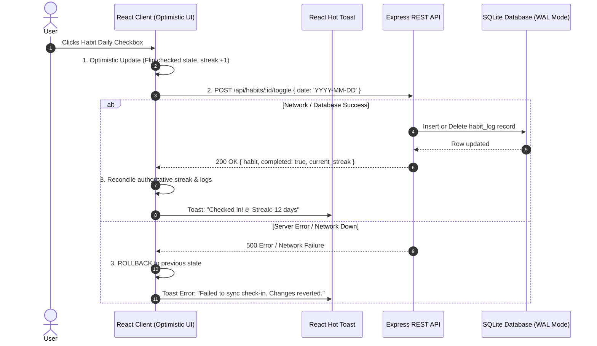

# HabitFlow — Full-Stack Habit & Daily Goal Tracker

A complete, responsive, and modern Full-Stack Habit & Daily Goal Tracker web application built with a high-performance **React (Vite) + Tailwind CSS** frontend and a robust **Node.js (Express) + SQLite** backend.

---

## 📸 Screenshots Showcase

> *Replace the image paths below with your application screenshots.*

### 1. Dashboard View
*Responsive habit cards with category badges, daily completion checkbox, active streak counters, and Monday–Sunday weekly progress indicators.*
```
+----------------------------------------------------------------------------------------------------+
|  🔥 HabitFlow PRO            [ Dashboard ] [ Historical Trends ]         [🟢 Synced] [+ New Habit]  |
+----------------------------------------------------------------------------------------------------+
|  [ Today's Progress: 4/6 (67%) ] [ Active Streaks: 5 🔥 ] [ Top Streak: 18d ] [ Record: 23d 🏆 ]    |
|  [ All Habits ] [ Mindfulness ] [ Health & Fitness ] [ Productivity ]   [ Search habits...       ]  |
|                                                                                                    |
|  +---------------------------+  +---------------------------+  +---------------------------+       |
|  | Mindfulness   Every day   |  | Health        5d / wk     |  | Learning      Every day   |       |
|  | Morning Meditation (15m)  |  | Daily 5km Run / Cardio    |  | Read Non-Fiction (20p)    |       |
|  | [✓] Completed Today       |  | [ ] Check-in Today        |  | [✓] Completed Today       |       |
|  | Streak: 12d | Record: 18d |  | Streak: 5d  | Record: 10d |  | Streak: 18d | Record: 23d |       |
|  | Week: [M][T][W][T][F][S][S]|  | Week: [M][T][W][T][F][S][S]|  | Week: [M][T][W][T][F][S][S]|       |
|  +---------------------------+  +---------------------------+  +---------------------------+       |
+----------------------------------------------------------------------------------------------------+
```
*(Placeholder: ``)*

### 2. Add / Edit Habit Modal
*Modal form with custom title, color palette picker, Lucide icon selector, and weekly target slider.*
```
+-------------------------------------------------------+
|  ● Create New Habit                               [X] |
+-------------------------------------------------------+
|  Habit Title *                                        |
|  [ e.g. Morning Run, Read 20 Pages                  ] |
|                                                       |
|  Category                                             |
|  [Mindfulness] [Health & Fitness] [Productivity] ...  |
|                                                       |
|  Color Tag                                            |
|  (🟢) (🟣) (🟡) (🔴) (🔵) (🟠)                        |
|                                                       |
|  Weekly Target: 7 days                                |
|  [1d] [2d] [3d] [4d] [5d] [6d] [7d]                   |
|                                                       |
|                             [ Cancel ] [ Create Habit]|
+-------------------------------------------------------+
```
*(Placeholder: ``)*

### 3. Historical Trends & Heatmap View
*35-day contribution matrix, day checklist inspector, category consistency breakdown, and all-time records.*
```
+----------------------------------------------------------------------------------------------------+
|  📊 Historical Trends & Matrix             Filter: [ All Habits v ]    Time Range: [14d] [35d] [60d]|
|  [ Total Check-ins: 183 ] [ Best Streak: 23d 🔥 ] [ Completion Rate: 84% ] [ Active Streaks: 6 ]   |
|                                                                                                    |
|  Contribution Heatmap (Past 35 Days):            | Day Checklist Inspector:                        |
|  [■][■][■][■][■][■][■]  Week 1                   | Fri, Nov 20 (83% Done)                          |
|  [■][■][■][■][■][■][■]  Week 2                   | [✓] Morning Meditation                          |
|  [■][■][■][■][■][■][■]  Week 3                   | [✓] Deep Work Session                           |
|  [■][■][■][■][■][■][■]  Week 4                   | [✓] Hydrate 2.5L Water                          |
|  [■][■][■][■][■][■][■]  Week 5                   | [ ] Daily 5km Run                               |
+----------------------------------------------------------------------------------------------------+
```
*(Placeholder: ``)*

---

## 🏗️ Architecture Overview

The application follows a clean monorepo architecture separating client and server concerns:

```
habit-tracker/
├── client/                     # Frontend Application (React + Vite)
│   ├── src/
│   │   ├── api/
│   │   │   └── habitsApi.js    # Centralized REST client with error normalization
│   │   ├── components/
│   │   │   ├── CategoryFilter.jsx    # Category pills, status filters & search
│   │   │   ├── DeleteConfirmModal.jsx# Safe habit deletion dialog
│   │   │   ├── EmptyState.jsx        # First-time onboarding & empty search state
│   │   │   ├── HabitCard.jsx         # Card with checkbox, streaks & weekly bar
│   │   │   ├── HabitModal.jsx        # Create/Edit form with color & icon picker
│   │   │   ├── HistoricalView.jsx    # Heatmap, trends, and day checklist inspector
│   │   │   ├── Navbar.jsx            # Brand header, tabs & network status
│   │   │   ├── StatsHeader.jsx       # Header KPI cards (today %, streaks, record)
│   │   │   └── WeeklyProgressBar.jsx # Mon-Sun interactive completion nodes
│   │   ├── context/
│   │   │   └── HabitContext.jsx      # Optimistic UI updates, sync & rollback
│   │   ├── App.jsx             # Main container
│   │   ├── main.jsx            # Application entry
│   │   └── index.css           # Tailwind CSS imports & theme styling
│   ├── package.json
│   └── vite.config.js          # Vite configuration with proxy to port 5000
│
├── server/                     # Backend API & Database (Express + SQLite)
│   ├── db/
│   │   ├── database.js         # SQLite connection (better-sqlite3 + WAL mode)
│   │   ├── schema.sql          # Explicit SQL schema DDL
│   │   └── setup.js            # Database initializer & 35-day seed script
│   ├── controllers/
│   │   └── habitController.js  # Request handlers, validation & status codes
│   ├── routes/
│   │   └── habitRoutes.js      # RESTful route definitions
│   ├── services/
│   │   └── habitService.js     # Streak algorithms, week indicators & aggregations
│   ├── test/
│   │   └── verify.js           # Automated verification test suite (7/7 tests)
│   ├── server.js               # Express entrypoint, CORS, error handling
│   └── package.json
│
├── package.json                # Root package with concurrently dev scripts
└── README.md                   # Comprehensive documentation
```

### Client-Server Flow & State Synchronization


---

## 🗄️ Database Schema (`schema.sql`)

```sql
PRAGMA foreign_keys = ON;

-- Habits Table
CREATE TABLE IF NOT EXISTS habits (
    id INTEGER PRIMARY KEY AUTOINCREMENT,
    title TEXT NOT NULL,
    description TEXT,
    category TEXT NOT NULL DEFAULT 'General',
    color TEXT NOT NULL DEFAULT '#3B82F6',
    icon TEXT DEFAULT 'target',
    frequency TEXT NOT NULL DEFAULT 'daily',
    target_days_per_week INTEGER DEFAULT 7,
    archived INTEGER NOT NULL DEFAULT 0,
    created_at TEXT NOT NULL DEFAULT (datetime('now', 'localtime')),
    updated_at TEXT NOT NULL DEFAULT (datetime('now', 'localtime'))
);

-- Habit Logs Table (Daily check-ins)
CREATE TABLE IF NOT EXISTS habit_logs (
    id INTEGER PRIMARY KEY AUTOINCREMENT,
    habit_id INTEGER NOT NULL REFERENCES habits(id) ON DELETE CASCADE,
    completed_date TEXT NOT NULL, -- Format: YYYY-MM-DD
    completed_at TEXT NOT NULL DEFAULT (datetime('now', 'localtime')),
    notes TEXT,
    UNIQUE(habit_id, completed_date)
);

-- Performance Indexes
CREATE INDEX IF NOT EXISTS idx_habits_category ON habits(category);
CREATE INDEX IF NOT EXISTS idx_habit_logs_date ON habit_logs(completed_date);
CREATE INDEX IF NOT EXISTS idx_habit_logs_habit ON habit_logs(habit_id);
CREATE INDEX IF NOT EXISTS idx_habit_logs_composite ON habit_logs(habit_id, completed_date);
```

---

## 🔌 REST API Endpoints

| Method | Endpoint | Description |
|---|---|---|
| `GET` | `/api/habits` | Fetch all habits with calculated streaks, weekly Mon–Sun progress, and recent logs |
| `POST` | `/api/habits` | Create a new habit (`title`, `category`, `color`, `icon`, `target_days_per_week`) |
| `GET` | `/api/habits/:id` | Get details and calculated metrics for a single habit |
| `PUT` | `/api/habits/:id` | Update habit details |
| `DELETE` | `/api/habits/:id` | Delete habit and cascade delete all associated completion logs |
| `POST` | `/api/habits/:id/toggle` | Toggle completion for a specific date (defaults to today) and return updated streak |
| `GET` | `/api/habits/history` | Historical matrix, 35-day heatmap data, and summary stats |
| `GET` | `/api/health` | Health check endpoint |

---

## ⚡ Step-by-Step Setup & Run Instructions

### Prerequisites
- **Node.js**: v18.0.0 or later (Node 20+ recommended)
- **npm**: v9.0.0 or later

---

### 1. Clone & Install Dependencies

From the repository root:

```bash
# 1. Install root dependencies (concurrently)
npm install

# 2. Install server dependencies
cd server
npm install

# 3. Install client dependencies
cd ../client
npm install

# 4. Return to root
cd ..
```

---

### 2. Database Initialization & Seeding

Run the seed script to create the SQLite schema and seed realistic sample habits with 35 days of history:

```bash
npm run setup
```
*(Or from `server/`: `npm run db:setup` or `node db/setup.js --reset`)*

Output:
```
🔄 Initializing database schema...
✅ Database schema initialized successfully.
🌱 Seeding sample habits and historical logs...
🎉 Database seeded successfully!
📊 Habits created: 6
📝 Completion logs created: 183
```

---

### 3. Run the Automated Verification Test Suite

Verify all 7 core features, streak algorithms, toggles, updates, and deletes:

```bash
npm test
```

Output:
```
🧪 Starting Full-Stack Habit Tracker Verification Test Suite...
1️⃣ Testing Database Setup & Seeding... ✅ DB verified: 6 habits, 183 logs.
2️⃣ Testing Habit Listing & Streak Logic... ✅ Streak calculation verified.
3️⃣ Testing Habit Creation (POST)... ✅ Created habit ID 7.
4️⃣ Testing Habit Check-in / Toggle... ✅ Consecutive streak verified.
5️⃣ Testing Habit Update (PUT)... ✅ Updated habit details.
6️⃣ Testing Historical Trends Query... ✅ Historical matrix verified.
7️⃣ Testing Habit Deletion (DELETE)... ✅ Cascaded logs deleted cleanly.
🎉 ALL 7 TEST SUITES PASSED FLAWLESSLY! 🚀
```

---

### 4. Start the Application

You can start both backend and frontend together with a single command from root:

```bash
npm run dev
```

Or start them individually in separate terminal tabs:

**Terminal 1 (Backend API):**
```bash
npm run server:dev
# Runs on http://localhost:5000
```

**Terminal 2 (Frontend Client):**
```bash
npm run client
# Runs on http://localhost:5173
```

Open your browser at **[http://localhost:5173](http://localhost:5173)** to use HabitFlow!

---

## 🧪 Features & Verification Checklist

- [x] **Full-Stack Monorepo Structure**: Clean separation of `client/` and `server/`.
- [x] **SQLite Database & Schema**: `db/schema.sql` with foreign keys, indexes, and `db/setup.js` seeding 6 habits + 180+ logs.
- [x] **Dashboard Habit Cards**: Habit title, category/color tag, daily check-in button, current streak, longest streak, and Mon–Sun weekly indicators.
- [x] **Interactive Modals**: Create, Edit, and Delete confirmation modals with color palettes and icon pickers.
- [x] **Real-Time Optimistic UI**: Check-ins toggle instantly with automatic rollback and error toasts if the server is down.
- [x] **Historical Trends View**: 35-day contribution heatmap, click-to-inspect day checklist, and category performance breakdown.
- [x] **Confetti Celebration**: Fires rewarding confetti when streaks milestone or all daily habits are completed.
- [x] **RESTful API**: Complete REST endpoints for habits, toggling, and history with centralized error handling.
- [x] **Automated Test Suite**: 7 unit/integration verification tests passed.
